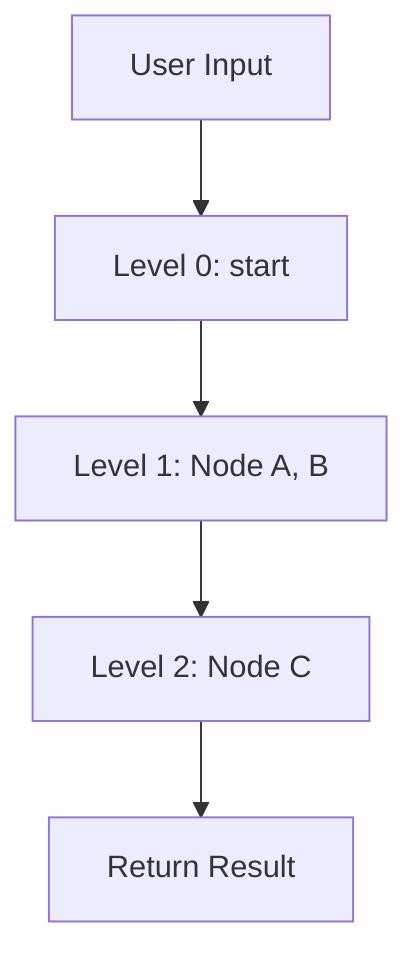
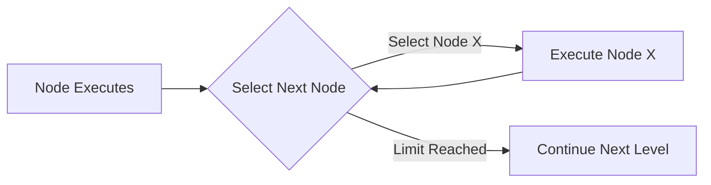

# Graph Execution

Graphs execute nodes level by level.

## Execution Flow

**Execution Rules:**
- Nodes at the same level execute sequentially
- Each node waits for upstream nodes to complete
- Nodes receive upstream outputs as input

## Execution Modes

| Mode | Response | Use Case |
|------|----------|----------|
| **Stream** | Each node streams content output | Interactive tasks |
| **Background** | Immediate conversation ID | Long-running tasks |

## Failures and Resuming

Streaming and background runs use the same node order. If execution fails, it does not report a successful Graph completion. Open the conversation to inspect the available output before retrying.

When resuming from a saved checkpoint, execution continues after the last completed node, including remaining nodes at the same level. For example, if A completed and B failed at the same level, resuming runs B and its successors without repeating A. Existing conversation records can be resumed without migration.

Only one run can update a conversation at a time within the application process. If another run is active, wait for it to finish before retrying; different conversations can run concurrently. Background execution continues after its start response, but application shutdown interrupts active runs.

## Handoffs Execution

Nodes with Handoffs can dynamically choose the next step:

Each Handoffs node has a selection count limit, automatically continues normal flow when limit is reached.

## Final Output

| Method | Description |
|--------|-------------|
| **Use Template** | Configure `end_template`, use `{{node_name}}` to reference node outputs |
| **Last Node** | Use output from the last executed node |

## Next Steps

- **[Graph Configuration](config.md)** - Learn how to configure graphs
- **[Handoffs](handoffs.md)** - Implement dynamic routing
- **[Subgraphs](subgraph.md)** - Build modular workflows
