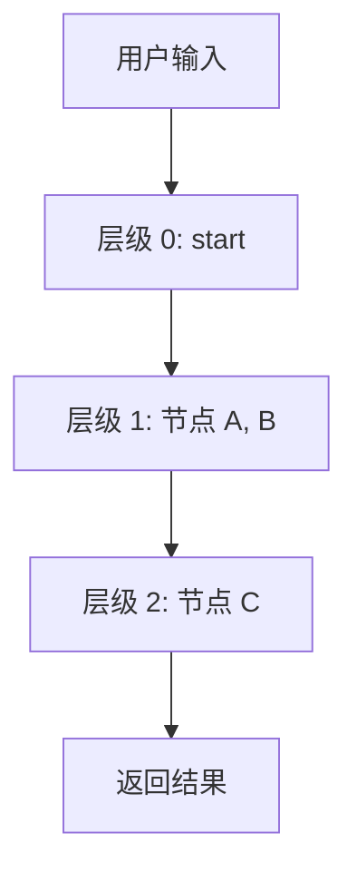
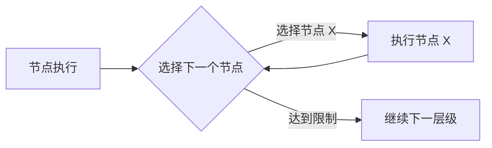

# Graph 执行

Graph 按层级逐层执行节点。

## 执行流程

**执行规则：**
- 同一层级的节点按顺序执行
- 每个节点等待上游节点完成
- 节点接收上游输出作为输入

## 执行模式

| 模式 | 响应方式 | 适用场景 |
|------|---------|---------|
| **流式** | 每个节点流式输出内容 | 交互式任务 |
| **后台** | 立即返回会话 ID | 长时间任务 |

## 失败与恢复

流式和后台运行遵循相同的节点顺序。执行失败时，不会报告 Graph 成功完成。重试前可打开会话检查已有输出。

从保存的检查点恢复时，会接着最后一个已完成节点继续执行，包括同层剩余节点。例如，同层 A 已完成而 B 失败，恢复会执行 B 及其后继，不重复 A。已有会话记录无需迁移即可恢复。

在一个应用进程内，同一会话一次只能由一个运行修改。已有运行进行中时，请等待其结束再重试；不同会话可以并发。后台执行会在启动响应返回后继续，但应用关闭会中断活跃运行。

## Handoffs 执行

带 Handoffs 的节点可以动态选择下一步：

每个 Handoffs 节点有选择次数限制，达到限制后自动继续正常流程。

## 最终输出

| 方式 | 说明 |
|------|------|
| **使用模板** | 配置 `end_template`，用 `{{节点名}}` 引用节点输出 |
| **最后节点** | 使用最后执行节点的输出 |

## 下一步

- **[Graph 配置](config.zh.md)** - 了解如何配置 Graph
- **[Handoffs](handoffs.zh.md)** - 实现动态路由
- **[子图](subgraph.zh.md)** - 构建模块化工作流
